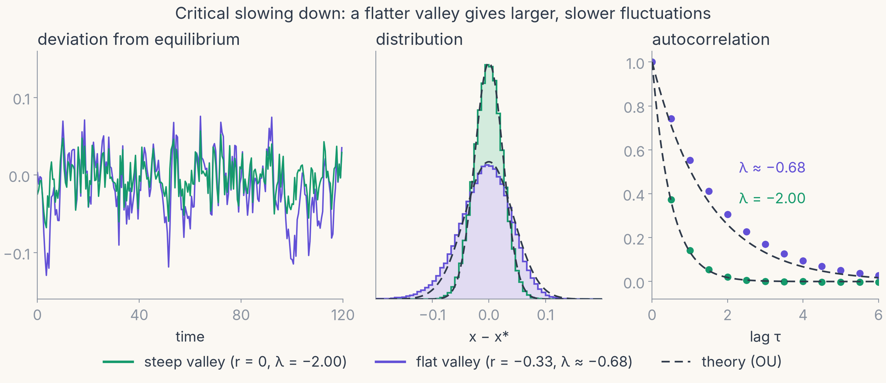
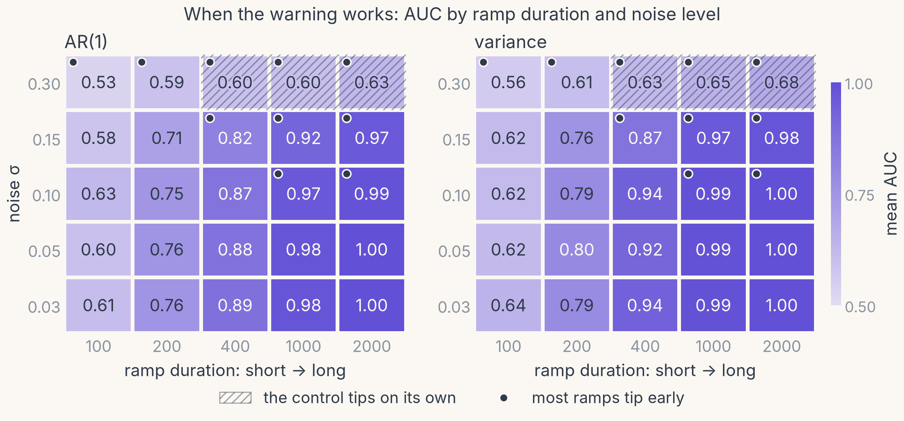

# tipping-early-warning

A simulation study of whether rising variance and lag-1 autocorrelation in a noisy time series warn of an approaching tipping point, tested against a control group in a model with known ground truth.

## The question

Many systems can sit in a stable state for a long time and then shift abruptly to another one: a lake that turns from clear to turbid, a climate component, an ecosystem. If such a transition is a bifurcation, the system should show generic symptoms beforehand. Do those symptoms exist in noisy data, can they be measured reliably, and when do they fail?

This repository answers the question in a toy model where the truth is known exactly, so every claim about detection can be checked against what the system actually did.

## The idea

The model is an overdamped particle in a tilted double-well potential, driven by white noise:

$$
dx = \left(r + x - x^{3}\right)dt + \sigma\,dW .
$$

The deterministic part is $f(x,r) = r + x - x^3 = -\partial V/\partial x$ with $V(x,r) = -rx - x^2/2 + x^4/4$. For $\lvert r\rvert < r_c$ there are two stable equilibria separated by an unstable one. The control parameter $r$ tilts the potential. At

$$
r = -r_c = -\frac{2}{3\sqrt{3}} \approx -0.3849
$$

the upper stable equilibrium collides with the unstable one and both disappear in a saddle-node bifurcation (also called fold or tangent bifurcation). A system that was resting on the upper branch then has to jump to the lower one, a drop of $\sqrt{3}$.


### Why variance and AR(1) rise

Near a stable equilibrium $x^*$ the dynamics linearise. With $y = x - x^*$ and growth rate $\lambda = f'(x^*) = 1 - 3x^{*2} < 0$,

$$
dy = \lambda\,y\,dt + \sigma\,dW ,
$$

an Ornstein–Uhlenbeck process. Its stationary variance and its autocorrelation after a lag $\tau$ are

$$
\operatorname{Var}(y) = \frac{\sigma^{2}}{2\lvert\lambda\rvert}, \qquad \rho(\tau) = e^{\lambda\tau}.
$$

Sampled every $\Delta t$, the series is an AR(1) process with coefficient $\phi = e^{\lambda\,\Delta t}$. As $r \to -r_c$, $\lvert\lambda\rvert \to 0$: the valley flattens, recovery from perturbations slows down (critical slowing down), the variance grows like $1/\lvert\lambda\rvert$ and $\phi \to 1$. Both quantities can be estimated from a time series without knowing the model. The derivation is in [docs/math.md](docs/math.md).



### The experiment

Each experiment compares two groups of simulated runs: a ramp group in which $r$ decreases linearly towards and through the fold, and a control group with constant $r = 0$. Rolling variance and rolling lag-1 autocorrelation are computed on the detrended series, and the Kendall rank correlation $\tau$ of each indicator against time measures how strongly it trends. A good early-warning signal gives larger $\tau$ in the ramp group than in the control group; this is summarised by the AUC and by the true-positive rate at a 5% false-positive rate. A sweep over noise level $\sigma$ and ramp duration shows where the signal stops working.




## Results

<!-- RESULTS:START -->
Results will be inserted here after the parameter sweep has been run (`uv run tipping reproduce`).
<!-- RESULTS:END -->

## Quickstart

Requirements: [uv](https://docs.astral.sh/uv/) (it installs the right Python automatically). [just](https://github.com/casey/just) is optional. New to Git on Windows? See [docs/windows-setup.md](docs/windows-setup.md).

### Windows (PowerShell)

```powershell
powershell -ExecutionPolicy ByPass -c "irm https://astral.sh/uv/install.ps1 | iex"
uv sync --group dev --extra deck
uv run pytest
uv run tipping simulate
uv run tipping reproduce
```

### Linux and macOS

```bash
curl -LsSf https://astral.sh/uv/install.sh | sh
uv sync --group dev --extra deck
uv run pytest
uv run tipping simulate
uv run tipping reproduce
```

### Command reference

| Command | What it does |
| --- | --- |
| `uv run tipping simulate` | Baseline ramp-versus-control experiment; prints a summary table. Options: `--config`, `--seed`, `--n-runs`, `--duration`, `--sigma`. |
| `uv run tipping sweep` | Noise-by-duration sweep; writes the tables to `results/`. |
| `uv run tipping figures --lang en` | Static figures as PNG (`es` or `en`). |
| `uv run tipping animate --lang es` | MP4 animations and poster frames. |
| `uv run tipping reproduce` | Sweep, figures (es and en) and animations in one go. |

With `just` installed, the same steps are shortcuts: `just setup`, `just test`, `just lint`, `just format`, `just typecheck`, `just check` (lint, typecheck and test), `just simulate`, `just sweep`, `just figures`, `just animate`, `just deck`, `just reproduce`, `just clean`. Run `just` without arguments to list them.

## Project layout

```text
tipping-early-warning/
├── configs/
│   ├── default.yaml        baseline experiment
│   └── sweep.yaml          sweep grid and seeds
├── src/tipping/
│   ├── model.py            drift, potential, closed-form equilibria, stability
│   ├── theory.py           Ornstein-Uhlenbeck predictions (variance, ACF, AR(1))
│   ├── simulate.py         Euler-Maruyama simulator, ramps
│   ├── indicators.py       detrending, rolling variance and AR(1), Kendall tau
│   ├── evaluate.py         AUC, TPR at fixed FPR, bootstrap confidence intervals
│   ├── sweep.py            parameter sweep
│   ├── io.py               Parquet reading and writing
│   ├── config.py           pydantic configuration models
│   ├── paths.py            project directories (honours TIPPING_ROOT)
│   ├── cli.py              command-line interface
│   └── viz/
│       ├── style.py        palette and matplotlib style
│       ├── labels.py       figure text in Spanish and English
│       ├── figures.py      static figures
│       └── animations.py   MP4 animations
├── tests/                  unit tests with analytical oracles
├── docs/
│   ├── math.md             derivations
│   ├── design.md           design decisions
│   ├── windows-setup.md    Git, uv and GitHub setup on Windows
│   └── assets/             generated figures used in this README
├── deck/                   slide deck (Spanish) and build script
├── data/  results/         generated, not tracked
├── justfile
└── pyproject.toml
```

## Reproducibility

- Every random draw comes from `numpy.random.default_rng(seed)`; there is no global random state.
- The baseline experiment is defined in `configs/default.yaml` (master seed 42). The sweep grid and its seeds are defined in `configs/sweep.yaml` (seeds 1, 2, 3).
- `uv.lock` pins every dependency; `uv sync` reproduces the environment.
- The project root can be overridden with the environment variable `TIPPING_ROOT`; otherwise it is located through `pyproject.toml`.
- Results are written to `results/sweep.parquet` (one row per noise level, duration and seed) and `results/sweep_summary.parquet` (mean over seeds with bootstrap 95% confidence intervals). Neither is committed.

The sweep table has the columns `sigma, duration, seed, n_runs, window, auc_var, auc_ar1, tpr_var, tpr_ar1, frac_ramp_tipped_early, frac_null_tipped, n_valid_ramp, n_valid_null`. Query it with DuckDB from the repository root:

```python
import duckdb

duckdb.sql("""
    SELECT sigma,
           duration,
           avg(auc_ar1)           AS auc_ar1,
           avg(auc_var)           AS auc_var,
           avg(frac_null_tipped)  AS frac_null_tipped
    FROM 'results/sweep.parquet'
    GROUP BY sigma, duration
    ORDER BY sigma, duration
""").show()
```

`frac_null_tipped` matters: at large noise even the control group tips, so it is not tip-free there.

## Limitations

- This is a toy model with a known ground truth. There is no real data, and a single real time series cannot estimate false-positive rates.
- Survivor bias: runs that tip early are truncated before analysis, which changes which runs enter the statistics.
- AUC hides that an alarm is useless if the system tips before the signal has built up.
- The linear Ornstein–Uhlenbeck theory degrades close to the fold and at large noise; there, noise-induced tipping (Kramers escape) can occur before the fold is reached.
- Early-warning signals indicate that a system is approaching a fold, not when it will tip.
- Detection depends on analyst choices, in particular the rolling window and the detrending.

## References

- Scheffer, M. et al. (2009). Early-warning signals for critical transitions. *Nature* 461, 53–59.
- Ashwin, P., Wieczorek, S., Vitolo, R. and Cox, P. (2012). Tipping points in open systems: bifurcation, noise-induced and rate-dependent examples in the climate system. *Philosophical Transactions of the Royal Society A* 370, 1166–1184.
- Strogatz, S. H. *Nonlinear Dynamics and Chaos*. Westview Press.
- Uhlenbeck, G. E. and Ornstein, L. S. (1930). On the theory of the Brownian motion. *Physical Review* 36, 823–841.

## License

MIT. See [LICENSE](LICENSE). Citation metadata is in [CITATION.cff](CITATION.cff).

## Author

Fernando
