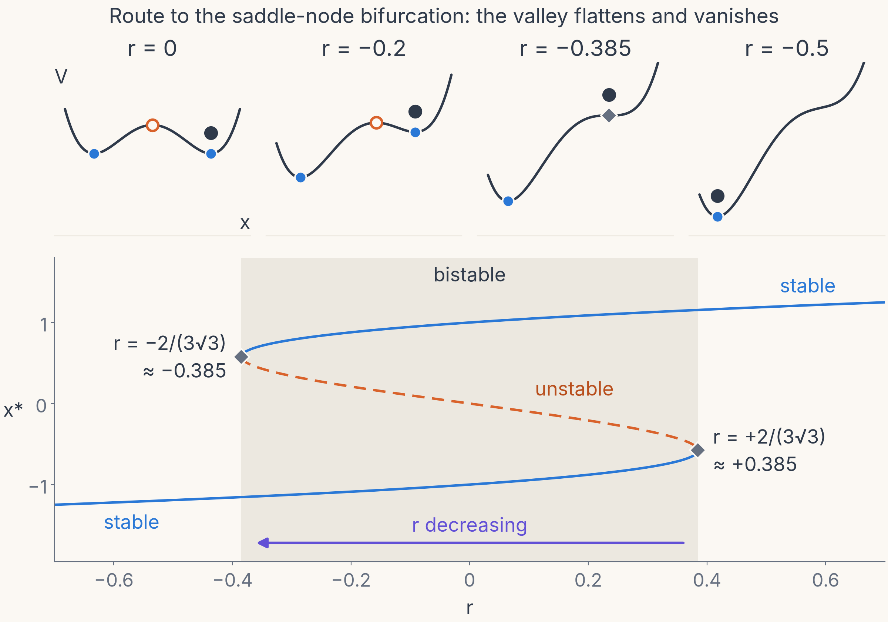
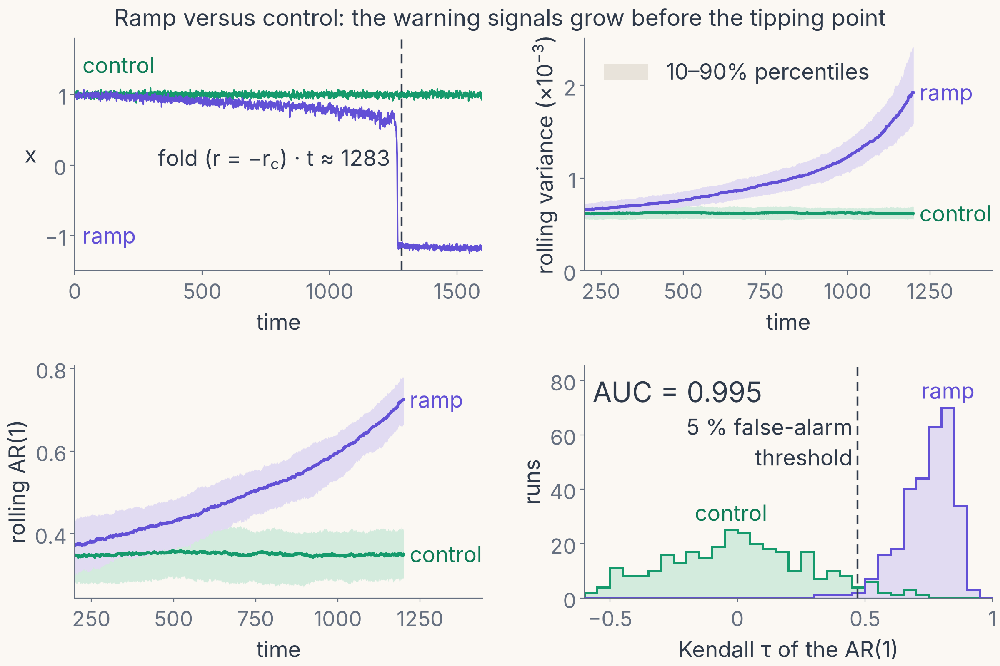

# tipping-early-warning

A simulation study of whether rising variance and lag-1 autocorrelation in a noisy time series warn of an approaching tipping point, tested against a control group in a model with known ground truth.

## The question

Many systems can sit in a stable state for a long time and then shift abruptly to another one: a lake that turns from clear to turbid, a climate component, an ecosystem. If such a transition is a bifurcation, the system should show generic symptoms beforehand. Do those symptoms exist in noisy data, can they be measured reliably, and when do they fail?

This repository answers the question in a toy model where the truth is known exactly, so every claim about detection can be checked against what the system actually did.

## The idea

The model is an overdamped particle in a tilted double-well potential, driven by white noise:

$$
dx = \left(r + x - x^{3}\right)dt + \sigma\,dW .
$$

The deterministic part is $f(x,r) = r + x - x^3 = -\partial V/\partial x$ with $V(x,r) = -rx - x^2/2 + x^4/4$. For $\lvert r\rvert < r_c$ there are two stable equilibria separated by an unstable one. The control parameter $r$ tilts the potential. At

$$
r = -r_c = -\frac{2}{3\sqrt{3}} \approx -0.3849
$$

the upper stable equilibrium collides with the unstable one and both disappear in a saddle-node bifurcation (also called fold or tangent bifurcation). A system that was resting on the upper branch then has to jump to the lower one, a drop of $\sqrt{3}$.



### Why variance and AR(1) rise

Near a stable equilibrium $x^*$ the dynamics linearise. With $y = x - x^*$ and growth rate $\lambda = f'(x^*) = 1 - 3x^{*2} < 0$,

$$
dy = \lambda\,y\,dt + \sigma\,dW ,
$$

an Ornstein–Uhlenbeck process. Its stationary variance and its autocorrelation after a lag $\tau$ are

$$
\operatorname{Var}(y) = \frac{\sigma^{2}}{2\lvert\lambda\rvert}, \qquad \rho(\tau) = e^{\lambda\tau}.
$$

Sampled every $\Delta t$, the series is an AR(1) process with coefficient $\phi = e^{\lambda\,\Delta t}$. As $r \to -r_c$, $\lvert\lambda\rvert \to 0$: the valley flattens, recovery from perturbations slows down (critical slowing down), the variance grows like $1/\lvert\lambda\rvert$ and $\phi \to 1$. Both quantities can be estimated from a time series without knowing the model. The derivation is in [docs/math.md](docs/math.md).


### The experiment

Each experiment compares two groups of simulated runs: a ramp group in which $r$ decreases linearly towards and through the fold, and a control group with constant $r = 0$. Rolling variance and rolling lag-1 autocorrelation are computed on the detrended series, and the Kendall rank correlation $\tau$ of each indicator against time measures how strongly it trends. A good early-warning signal gives larger $\tau$ in the ramp group than in the control group; this is summarised by the AUC and by the true-positive rate at a 5% false-positive rate. A sweep over noise level $\sigma$ and ramp duration shows where the signal stops working.




## Results

<!-- RESULTS:START -->
All numbers below are generated by `scripts/fill_readme.py` from `results/` (`key_numbers.json`, `sweep_summary.parquet`, `confound.json`).

**Baseline** (sigma = 0.05, ramp of 2000 time units, 300 ramp and 300 control runs, seed 42; rolling window 200 time units, analysis stops at 60% of the ramp). Intervals are 95% percentile bootstrap intervals that resample the runs of this single simulation; they do not include the variation between seeds.

| Indicator | AUC (95% CI) | TPR at 5% FPR | Median tau, ramp | Median tau, control |
| --- | --- | --- | --- | --- |
| variance | 0.9998 (0.9995 to 1.0000) | 1.00 | 0.84 | 0.01 |
| AR(1) | 0.9949 (0.9909 to 0.9982) | 0.99 (0.97 to 1.00) | 0.76 | 0.00 |

**Analysis horizon.** It was fixed in advance at 60% of the ramp, just before the fold, which the ramp reaches at t = 1283.5 (64% of the ramp). An analyst who knows where the fold is can pick such a horizon; with real data the fold position is unknown. The metrics depend strongly on that choice (baseline run, seed 42):

| Analysis stops at | t | Time before the fold | AUC variance | AUC AR(1) |
| --- | --- | --- | --- | --- |
| 30% | 600 | 683.5 | 0.817 | 0.705 |
| 40% | 800 | 483.5 | 0.950 | 0.872 |
| 50% | 1000 | 283.5 | 0.996 | 0.967 |
| 60% | 1200 | 83.5 | 0.999 | 0.995 |

**Tipping happens near the fold, and noise pulls it forward.** At baseline noise (sigma = 0.05) the median ramp run tips 20 time units before the fold (t = 1283.5) and 76% of the runs tip before it; the deterministic system would tip 28.5 time units after the fold. From sigma = 0.1 on, every ramp run tips by noise before the fold (median r at the tip -0.344 at sigma = 0.1 and -0.295 at sigma = 0.15, against r = -0.385 at the fold).

**Noise by ramp duration** (300 runs per group and cell, three seeds per cell). AUC of Kendall's tau, ramp against control:

*AUC of the variance (mean over three seeds):*

| sigma \ ramp duration (window, samples) | 100 (20) | 200 (40) | 400 (80) | 1000 (200) | 2000 (400) |
| --- | --- | --- | --- | --- | --- |
| 0.03 | 0.645 | 0.786 | 0.937 | 0.993 | 0.999 |
| 0.05 | 0.617 | 0.795 | 0.920 | 0.993 | 0.999 |
| 0.1 | 0.615 | 0.788 | 0.939 | 0.991 | 0.998 |
| 0.15 | 0.616 | 0.760 | 0.874 | 0.969 | 0.981 |
| 0.3 | 0.559 | 0.607 | 0.628 | 0.648 | 0.675 |

*AUC of AR(1) (mean over three seeds):*

| sigma \ ramp duration (window, samples) | 100 (20) | 200 (40) | 400 (80) | 1000 (200) | 2000 (400) |
| --- | --- | --- | --- | --- | --- |
| 0.03 | 0.609 | 0.758 | 0.886 | 0.980 | 0.997 |
| 0.05 | 0.598 | 0.756 | 0.879 | 0.979 | 0.997 |
| 0.1 | 0.627 | 0.753 | 0.873 | 0.969 | 0.990 |
| 0.15 | 0.584 | 0.710 | 0.824 | 0.923 | 0.966 |
| 0.3 | 0.531 | 0.594 | 0.599 | 0.602 | 0.630 |

*Share of ramp runs that tipped before the analysis horizon (noise-induced, before enough signal has built up):*

| sigma \ ramp duration (window, samples) | 100 (20) | 200 (40) | 400 (80) | 1000 (200) | 2000 (400) |
| --- | --- | --- | --- | --- | --- |
| 0.03 | 0% | 0% | 0% | 0% | 0% |
| 0.05 | 0% | 0% | 0% | 1% | 2% |
| 0.1 | 2% | 11% | 23% | 56% | 84% |
| 0.15 | 21% | 44% | 77% | 97% | 100% |
| 0.3 | 88% | 98% | 100% | 100% | 100% |

Variance matches or beats AR(1) almost everywhere: its seed-mean AUC is at least that of AR(1) in 24 of 25 cells (AR(1) is ahead at (sigma, duration) = (0.1, 100)). Paired by seed, the variance AUC is higher than the AR(1) AUC in all 3 seeds in 22 of 25 cells, in some seeds in 3 cells (at (sigma, duration) = (0.1, 100), (0.3, 100), (0.3, 1000)) and in no seed in 0. With constant noise the variance is therefore at least as good as AR(1); the advantage of AR(1) appears when the noise amplitude changes (below).

The rolling window is tied to the ramp duration in this sweep (10% of the duration, see the window sizes in the column headers), so duration and window length are not separated here. Separate checks (sigma = 0.05, one seed) show that both matter: with the same 10-unit window the variance AUC is 0.971 on the 2000-unit ramp and 0.635 on the 100-unit ramp (the ramp duration acts on its own), and on the short ramp a window of 30 units gives 0.737, higher than 0.635 (the window acts on its own).

*Seed variation.* The sweep has three seeds per cell. `auc_*_ci_lo` and `auc_*_ci_hi` in `results/sweep_summary.parquet` are percentile bootstrap limits of a mean of three values, which is effectively the range over the three seeds, not a confidence interval (the widest range in the AUC columns is 0.11).

**Where AR(1) helps: a changing noise amplitude.** The variance scales with sigma squared and the AR(1) does not, so when the noise grows while the system stays far from the fold the variance gives a false alarm and AR(1) does not. Pooled over 3 seeds (300 runs per group and seed, bootstrap intervals resample runs), with sigma rising from 0.05 to 0.15 at constant r = 0, the variance flags 100% of the runs at the 5% false-positive threshold (AUC 1.0000) while AR(1) flags 6% (AUC 0.5174, close to chance). When the fold approach has to be recognised against a background of rising noise, the AUC of the variance is 0.9041 and that of AR(1) is 0.9926.

| Scenario | AUC variance (95% CI) | AUC AR(1) (95% CI) | TPR variance | TPR AR(1) |
| --- | --- | --- | --- | --- |
| Fold approach, constant noise (positive control) | 0.9998 (0.9997 to 0.9999) | 0.9977 (0.9964 to 0.9987) | 1.00 | 0.99 |
| Noise rising to 0.10, r = 0 (false-alarm test) | 0.9999 (0.9998 to 0.9999) | 0.4892 (0.4626 to 0.5140) | 1.00 | 0.06 |
| Noise rising to 0.15, r = 0 (false-alarm test) | 1.0000 (1.0000 to 1.0000) | 0.5174 (0.4904 to 0.5451) | 1.00 | 0.06 |
| Fold approach and noise rising to 0.10, against noise rising alone | 0.9602 (0.9520 to 0.9671) | 0.9960 (0.9944 to 0.9973) | 0.82 | 0.98 |
| Fold approach and noise rising to 0.15, against noise rising alone | 0.9041 (0.8906 to 0.9173) | 0.9926 (0.9900 to 0.9947) | 0.65 | 0.96 |

**Reading the numbers.** The AUC is computed on the runs that survive long enough to be analysed, so read it together with the tipped shares above. At sigma = 0.3 and a ramp of 2000 the control group itself tips in 89% of the runs and only 112 of the ramp runs remain valid on average.
<!-- RESULTS:END -->

## Quickstart

Requirements: [uv](https://docs.astral.sh/uv/) (it installs the right Python automatically). [just](https://github.com/casey/just) is optional. Install from a clone of the repository (`uv sync` below, a development install): the YAML files in `configs/` and the `deck/` scripts are not packaged, so a wheel built from this project cannot run `tipping simulate` or `tipping sweep` on its own. New to Git on Windows? See [docs/windows-setup.md](docs/windows-setup.md).

### Windows (PowerShell)

```powershell
powershell -ExecutionPolicy ByPass -c "irm https://astral.sh/uv/install.ps1 | iex"
uv sync --locked --group dev --extra deck
uv run pytest
uv run tipping simulate
uv run tipping reproduce
```

### Linux and macOS

```bash
curl -LsSf https://astral.sh/uv/install.sh | sh
uv sync --locked --group dev --extra deck
uv run pytest
uv run tipping simulate
uv run tipping reproduce
```

### Command reference

| Command | What it does |
| --- | --- |
| `uv run tipping simulate` | Baseline ramp-versus-control experiment; prints a summary table. Options: `--config`, `--seed`, `--n-runs`, `--duration`, `--sigma`. |
| `uv run tipping sweep` | Noise-by-duration sweep; writes the tables to `results/`. |
| `uv run tipping confound` | Noise-amplitude confound experiment; writes `results/confound.parquet` and `results/confound.json`. |
| `uv run tipping key-numbers` | Every number quoted in the talk; writes `results/key_numbers.json` (needs the sweep). |
| `uv run tipping figures --lang en` | Static figures as PNG (`es` or `en`); the confound figure needs `results/confound.json`. |
| `uv run tipping animate --lang es` | MP4 animations and poster frames. |
| `uv run tipping deck [--repo-url URL]` | Build the slide deck into `deck/build/` (needs the `deck` extra and the files in `results/`). |
| `uv run tipping reproduce` | Sweep, confound, key numbers, figures (es and en) and animations (es) in one go. |
| `uv run python scripts/fill_readme.py` | Rewrite the results block of this README from `results/`. |

With `just` installed, the same steps are shortcuts: `just setup`, `just test`, `just lint`, `just format`, `just typecheck`, `just check` (lint, typecheck and test), `just simulate`, `just sweep`, `just confound`, `just key-numbers`, `just figures`, `just animate`, `just deck`, `just readme`, `just reproduce`, `just clean`. Run `just` without arguments to list them.

## Project layout

```text
tipping-early-warning/
├── configs/
│   ├── default.yaml        baseline experiment
│   └── sweep.yaml          sweep grid and seeds
├── src/tipping/
│   ├── model.py            drift, potential, closed-form equilibria, stability
│   ├── theory.py           Ornstein-Uhlenbeck predictions (variance, ACF, AR(1))
│   ├── simulate.py         Euler-Maruyama simulator, ramps
│   ├── indicators.py       detrending, rolling variance and AR(1), Kendall tau
│   ├── evaluate.py         AUC, TPR at fixed FPR, bootstrap confidence intervals
│   ├── sweep.py            parameter sweep
│   ├── confound.py         noise-amplitude confound experiment
│   ├── key_numbers.py      every number quoted in the talk (results/key_numbers.json)
│   ├── io.py               Parquet reading and writing
│   ├── config.py           pydantic configuration models
│   ├── paths.py            project directories (honours TIPPING_ROOT)
│   ├── cli.py              command-line interface
│   └── viz/
│       ├── style.py        palette and matplotlib style
│       ├── labels.py       figure text in Spanish and English
│       ├── figures.py      static figures
│       ├── figures_extra.py  confound figure
│       └── animations.py   MP4 animations
├── scripts/
│   └── fill_readme.py      fills the results block of this README from results/
├── tests/                  unit tests with analytical oracles
├── docs/
│   ├── math.md             derivations
│   ├── design.md           design decisions
│   ├── windows-setup.md    Git, uv and GitHub setup on Windows
│   └── assets/             generated figures used in this README
├── deck/
│   ├── build_deck.py       slide deck (Spanish), built from results/key_numbers.json
│   ├── export_notes.py     speaker notes from the talk script to notes.json
│   └── guion.md            talk script (Spanish)
├── data/  results/         generated, not tracked
├── justfile
└── pyproject.toml
```

## Reproducibility

- Every random draw comes from `numpy.random.default_rng(seed)`; there is no global random state.
- The baseline experiment is defined in `configs/default.yaml` (master seed 42). The sweep grid and its seeds are defined in `configs/sweep.yaml` (seeds 1, 2, 3).
- `uv.lock` pins every dependency; `uv sync` reproduces the environment.
- The project root can be overridden with the environment variable `TIPPING_ROOT`; otherwise it is located through `pyproject.toml`.
- Results are written to `results/sweep.parquet` (one row per noise level, duration and seed) and `results/sweep_summary.parquet` (mean over seeds with the `*_ci_lo` / `*_ci_hi` columns). Those two columns are a percentile bootstrap of the mean of the seed values; with the default three seeds they are effectively the range over the three seeds and should be read as a range indicator, not as a confidence interval. Neither file is committed.

The sweep table has the columns `sigma, duration, seed, n_runs, window, auc_var, auc_ar1, tpr_var, tpr_ar1, frac_ramp_tipped_early, frac_null_tipped, n_valid_ramp, n_valid_null`. Query it with DuckDB from the repository root:

```python
import duckdb

duckdb.sql("""
    SELECT sigma,
           duration,
           avg(auc_ar1)           AS auc_ar1,
           avg(auc_var)           AS auc_var,
           avg(frac_null_tipped)  AS frac_null_tipped
    FROM 'results/sweep.parquet'
    GROUP BY sigma, duration
    ORDER BY sigma, duration
""").show()
```

`frac_null_tipped` matters: at large noise even the control group tips, so it is not tip-free there.

### Fonts and file formats

- Figures use Inter if it is installed, otherwise Segoe UI, Calibri or DejaVu Sans. The committed PNGs in `docs/assets/` were rendered with Inter, so regenerating them on a machine without it can change the text rendering slightly (the data are identical).
- Animations are encoded through `imageio-ffmpeg`, which downloads or bundles an ffmpeg binary that is licensed under the GPL (it includes libx264). This repository does not redistribute that binary.

## Limitations

- This is a toy model with a known ground truth. There is no real data, and a single real time series cannot estimate false-positive rates.
- Survivor bias: runs that tip early are truncated before analysis, which changes which runs enter the statistics.
- AUC hides that an alarm is useless if the system tips before the signal has built up.
- The linear Ornstein–Uhlenbeck theory degrades close to the fold and at large noise; there, noise-induced tipping (Kramers escape) can occur before the fold is reached.
- Early-warning signals indicate that a system is approaching a fold, not when it will tip.
- Detection depends on analyst choices, in particular the rolling window and the detrending.

## References

- Scheffer, M. et al. (2009). Early-warning signals for critical transitions. *Nature* 461, 53–59.
- Ashwin, P., Wieczorek, S., Vitolo, R. and Cox, P. (2012). Tipping points in open systems: bifurcation, noise-induced and rate-dependent examples in the climate system. *Philosophical Transactions of the Royal Society A* 370, 1166–1184.
- Strogatz, S. H. *Nonlinear Dynamics and Chaos*. Westview Press.
- Uhlenbeck, G. E. and Ornstein, L. S. (1930). On the theory of the Brownian motion. *Physical Review* 36, 823–841.

## License

MIT. See [LICENSE](LICENSE). Citation metadata is in [CITATION.cff](CITATION.cff).

## Author

Fernando
